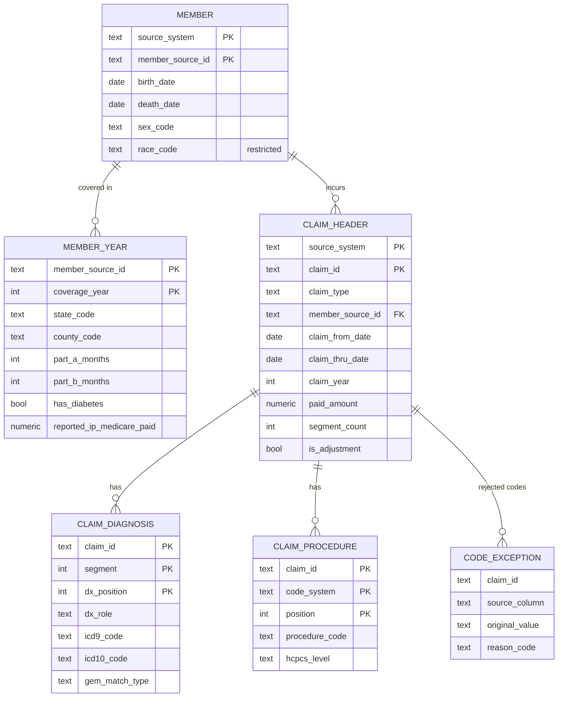

# Silver Canonical Model (v1)

**Scope:** legacy claims (DE-SynPUF) now; EDI X12, FHIR R4, and HL7 v2 sources will map into the same tables in later phases.
**Mapping:** `docs/mapping/sttm_desynpuf.csv` (column-level source-to-target rules)
**Rules source:** `docs/profiling/desynpuf_findings.md` (F1–F16)

## Design principles

1. **Source-agnostic.** Every table carries `source_system`. Keys are `(source_system, natural_key)`, so IDs from different systems can never collide (F15).
2. **Typed.** Dates are `DATE`, money is `NUMERIC(14,2)`, counts are `INTEGER`. Codes and identifiers stay `TEXT` end to end (F10).
3. **Traceable.** Every row carries lineage back to bronze (`_batch_id`, `_source_file`, source row numbers).
4. **Nothing disappears.** Rejected rows and values go to `quarantine` with a reason code. Reconciliation: *bronze = silver + quarantine*, in rows and dollars.
5. **History preserved.** Yearly member snapshots are kept as-is in silver; SCD Type 2 is derived in gold (F7).

## Tables

| Table | Grain | Primary key | Purpose |
|---|---|---|---|
| `silver.member` | One row per source member | `source_system, member_source_id` | Stable demographics (birth, death, sex, race) |
| `silver.member_year` | One row per member per coverage year | `source_system, member_source_id, coverage_year` | Geography, coverage months, chronic conditions, reported annual reimbursement |
| `silver.claim_header` | One row per claim (all segments rolled up) | `source_system, claim_id` | Dates, providers, DRG, total dollars, flags |
| `silver.claim_diagnosis` | One row per diagnosis on a claim | `source_system, claim_id, segment, dx_position` | Unpivoted ICD-9 diagnoses plus ICD-10 conversion |
| `silver.claim_procedure` | One row per procedure code on a claim | `source_system, claim_id, segment, code_system, position` | Unpivoted ICD-9 procedures and HCPCS |
| `quarantine.claim_exception` | One row per rejected claim segment | `source_system, source_table, _source_row_num` | Orphan segments and other row-level rejects |
| `quarantine.code_exception` | One row per rejected code value | `source_system, source_table, _source_row_num, source_column` | Invalid, misplaced, or placeholder codes |

## Key rules (summary; full detail in the STTM)

| Rule | Detail | Finding |
|---|---|---|
| Claim roll-up | Header attributes and dates from segment 1; dollar columns summed across all segments | F1, F11 |
| Orphan segments | Segment 2 without segment 1 → `quarantine.claim_exception` (`ORPHAN_SEGMENT`) | F12 |
| Claim year | `EXTRACT(YEAR FROM claim_thru_date)` | F13 |
| Adjustments | `is_adjustment = paid_amount < 0`; retained in all totals | F2 |
| Diagnosis unpivot | `ICD9_DGNS_CD_1..10` + admitting dx → rows; nulls dropped; principal = segment 1, position 1 | F8, F9 |
| Placeholder dx | `OTHER` → `code_exception` (`PLACEHOLDER_CODE`); header flag `primary_dx_missing` | F5 |
| Procedure validation | Each value validated against the code system its column claims; mismatches → `WRONG_CODE_SYSTEM` | F3 |
| HCPCS junk | `SCI_NOTATION`, `REVENUE_CODE`, `TRUNCATED`, `NON_CODE_TEXT` | F4 |
| Outpatient ICD-9 procedures | Not mapped (≈100% empty; outpatient uses HCPCS) | F6 |
| ICD-9 → ICD-10 | Via CMS 2018 GEMs; match type recorded; detailed rules in the conversion spec (next step) | Conversion spec |

## Silver reconciliation checks

| Check | Must hold |
|---|---|
| Segment rows | Bronze claim rows = Σ `claim_header.segment_count` + `quarantine.claim_exception` rows |
| Paid dollars | Bronze Σ `clm_pmt_amt` = Σ `claim_header.paid_amount` + Σ quarantined `paid_amount` |
| Diagnosis values | Non-null bronze dx values = `claim_diagnosis` rows + dx rows in `code_exception` |
| Member years | Bronze beneficiary rows = `member_year` rows |
| Enrollment integrity | Every `claim_header` has a `member_year` for `claim_year` (must be 0 failures, F14) |

## HIPAA notes

- `race_code` and birth/death dates are PHI-adjacent and will be masked or generalized in analyst-facing views (Phase 4 roles).
- All data is synthetic; the controls are implemented as if it were real PHI.
